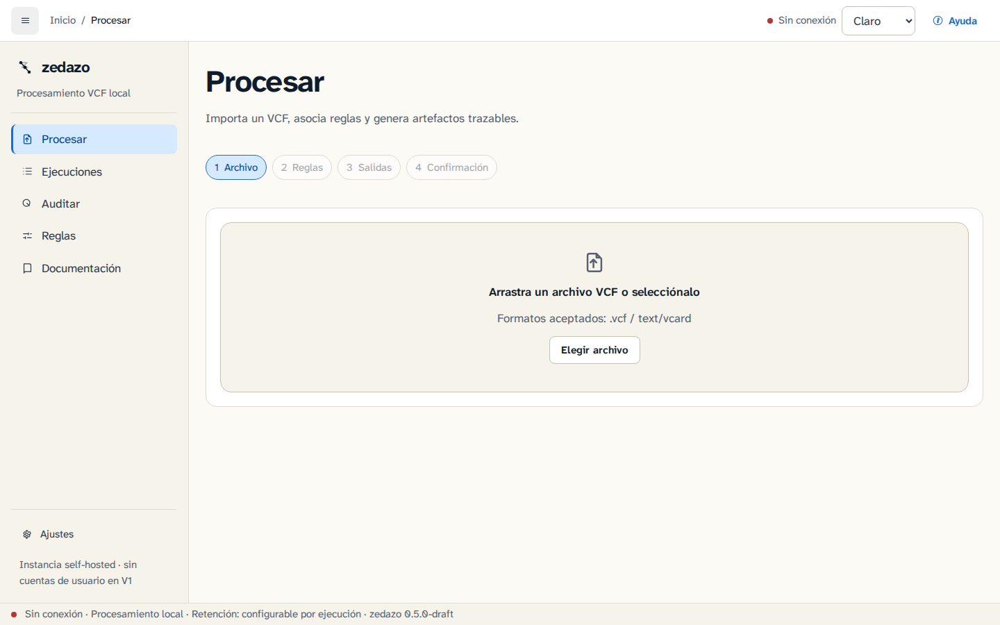
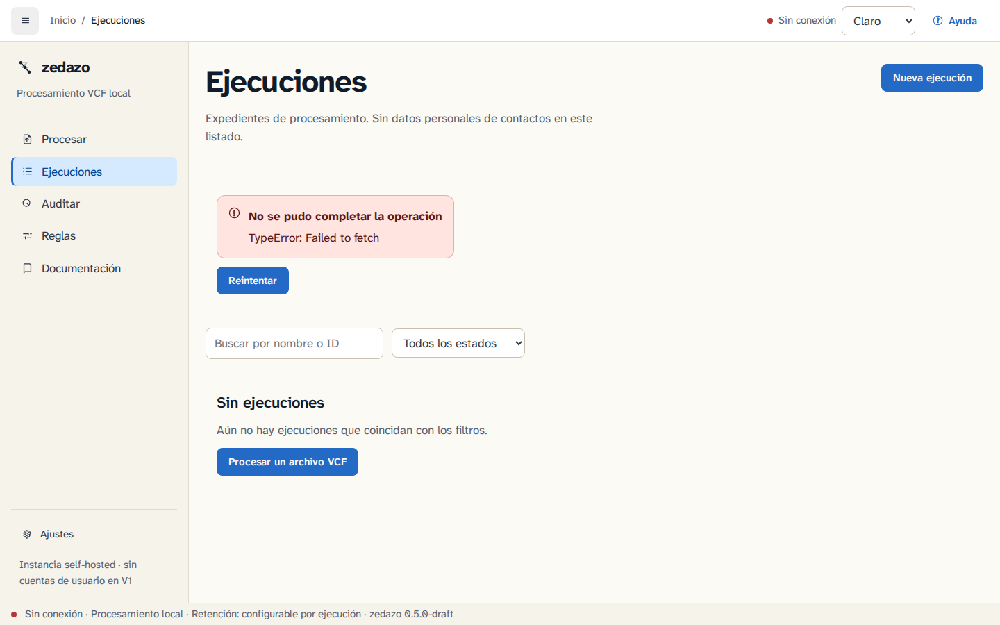
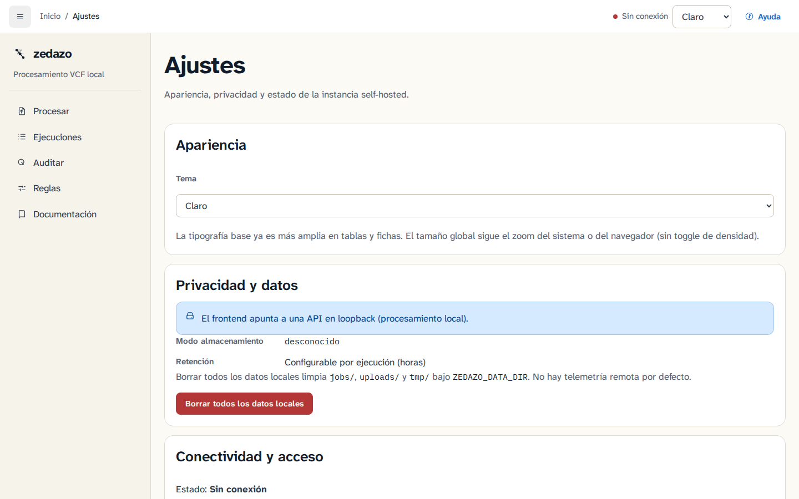

# Escritorio AppImage (Ubuntu 26)

**Traza:** ADR-0021, ROADMAP v0.6.0.  
**Destino de prueba:** Ubuntu 26. Build CI en runner compatible (p. ej. `ubuntu-22.04`).

Guía del binario Linux empaquetado con Tauri v2: GUI estática + API same-process en loopback. No sustituye Docker/Caddy remoto ([ADR-0016](../DECISIONS.md), [docs/gui/deploy.md](gui/deploy.md)).

## Requisitos

- Ubuntu 26 (o derivada reciente con WebKitGTK disponible).
- FUSE 2 para montar el AppImage, **o** el modo extract-and-run (sin FUSE).
- GPU NVIDIA (opcional): ver nota WebKit más abajo.

## Descargar y ejecutar

1. Obtén el `.AppImage` del draft de release `v0.6.0` (artefacto CI; no crates.io).
2. Marca ejecutable y lanza:

```bash
chmod +x zedazo_*.AppImage
./zedazo_*.AppImage
```

### FUSE (`libfuse2t64`) o extract-and-run

Si el kernel/usuariospace no monta AppImages (error típico de FUSE):

```bash
# Opción A — paquete FUSE 2 en Ubuntu 26
sudo apt install libfuse2t64

# Opción B — sin FUSE: extrae y ejecuta
./zedazo_*.AppImage --appimage-extract-and-run
```

### NVIDIA + WebKit (DMABUF)

Si el webview falla al arrancar o muestra pantalla negra con drivers NVIDIA:

```bash
WEBKIT_DISABLE_DMABUF_RENDERER=1 ./zedazo_*.AppImage
```

Puedes exportar la variable en tu sesión o en un launcher `.desktop` local.

## Rutas XDG

El escritorio respeta las variables XDG (defaults si no están definidas):

| Uso | Variable | Default |
|-----|----------|---------|
| Configuración | `XDG_CONFIG_HOME` | `~/.config/zedazo` |
| Datos (jobs, artefactos) | `XDG_DATA_HOME` | `~/.local/share/zedazo` |
| Estado (runtime/cache ligero) | `XDG_STATE_HOME` | `~/.local/state/zedazo` |

La API escucha solo en `127.0.0.1` (puerto efímero). Auth de sesión = token loopback inyectado al webview (ADR-0021); no uses el modelo remoto HTTPS+cookie del AppImage.

## Flujo operador: Proton → Procesar → audit.tsv

1. Exporta contactos desde Proton (VCF). Para prueba sin PII usa el fixture sintético [`examples/sample.vcf`](../examples/sample.vcf).
2. Abre **Procesar** en la GUI, sube el VCF.
3. Al completar el job, descarga el artefacto de auditoría (`audit.tsv`) y, si aplica, el VCF cribado.
4. Comprueba **I7**: el fichero de origen no se sobrescribe; la salida va a otra ruta / descarga.

Equivalencia CLI (misma semántica, [matriz O10](gui/functional-parity-matrix.md)):

```bash
zedazo cribar examples/sample.vcf -o /tmp/limpio.vcf -a /tmp/audit.tsv
```

Capturas de referencia (GUI web; el shell del AppImage es el mismo producto): ver [Capturas](#capturas) y [`docs/screenshots/`](screenshots/).

## Privacidad (local)

- Sin red saliente por defecto (misma postura que CLI/API local).
- Datos de jobs bajo XDG data; no se envían a servidores de Zedazo.
- Fixtures y demos: **100 % sintéticos**; no subas agendas reales a issues ni capturas.
- Cierra la ventana para apagar el servidor loopback embebido.

## Desinstalación

1. Borra el fichero `.AppImage` (y, si usaste extract-and-run, el directorio `squashfs-root/` generado).
2. Opcional — limpia estado local:

```bash
rm -rf "${XDG_CONFIG_HOME:-$HOME/.config}/zedazo"
rm -rf "${XDG_DATA_HOME:-$HOME/.local/share}/zedazo"
rm -rf "${XDG_STATE_HOME:-$HOME/.local/state}/zedazo"
```

No hay paquete `apt`/`dpkg` que desinstalar: el AppImage es portable.

## Capturas

| Procesar | Ejecuciones | Ajustes |
| --- | --- | --- |
|  |  |  |

Más temas y rutas: [`docs/screenshots/README.md`](screenshots/README.md). Regeneración opt-in: `ZEDAZO_SCREENSHOTS=1` (fuera de `web-ci`).

## Sample sintético

```bash
cp examples/sample.vcf /tmp/sample.vcf
# En el AppImage: Procesar → subir /tmp/sample.vcf
# Alternativa CLI:
zedazo cribar /tmp/sample.vcf -o /tmp/limpio.vcf -a /tmp/audit.tsv
```

Fixtures adicionales (solo tests): `crates/zedazo-core/tests/fixtures/*.vcf` (p. ej. `proton_sample.vcf`).

## Métricas

Tamaño del AppImage y TTFB de `GET /health` en loopback: [docs/gui/benchmarks.md](gui/benchmarks.md).

Artefacto CI típico (job `Desktop AppImage`, runner `ubuntu-22.04`): ~78–80 MiB el `.AppImage` (p. ej. run A6 `desktop-appimage` ≈ 78,2 MiB). Las cifras exactas de TTFB health y el doble-build (S-10) salen del log del job; B4 las copia cuando haya un run estable del tip del plan.

Notas de build/gates: [`apps/desktop/NOTES.md`](../apps/desktop/NOTES.md).

## CI: sin red y Ubuntu 26

- **P-02 / `desktop-no-network`:** el e2e AppImage corre bajo `unshare -rn` + `strace -f -e trace=connect` (`scripts/desktop/e2e-no-network.sh`). Falla si hay `connect` a IP distinta de `127.0.0.1` / `::1`. Los `AF_UNIX` (X11/DBus) se ignoran. Forma parte de `ci-gate`.
- **P-07 / smoke en `container: ubuntu:26.04`:** no está en `ci-gate`. Probe 2026-10-26: con `libwebkit2gtk-4.1-0`, xvfb y `--appimage-extract-and-run` la API llega a escuchar en loopback, pero el proceso aborta o queda inutilizable por EGL (`Could not create default EGL display: EGL_BAD_PARAMETER`) y choques de símbolos GIO/libcurl-gnutls (`nghttp2_option_set_no_rfc9113_leading_and_trailing_ws_validation`). No se añade un job rojo ni `continue-on-error` al gate. **Validación Ubuntu 26 = prueba manual del operador** en máquina real (esta guía).

## Ver también

- [ADR-0021](../DECISIONS.md) — decisión de producto (escritorio AppImage)
- [ROADMAP v0.6.0](../ROADMAP.md) — criterio de salida
- [Matriz de paridad CLI↔GUI](gui/functional-parity-matrix.md)
- [Deploy self-hosted](gui/deploy.md) — camino Docker/Caddy (no AppImage)
- [`apps/desktop/NOTES.md`](../apps/desktop/NOTES.md) — gates locales y limitaciones WebKit/build
