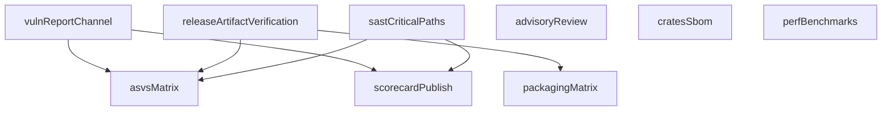

# Capability Map: auditoría de seguridad

Mapa de capacidades derivado del informe de auditoría pública, **corregido contra el árbol local** (tag **v0.6.4**). Esta fase solo documenta; no cambia CI, `deny.toml`, workflows ni código.

Las specs de módulo viven junto a este mapa (`SPEC-<id>.md`). No sustituyen a [`SPECS.md`](../../../SPECS.md). No se editan [`tasks/plan.md`](../../../tasks/plan.md) ni [`tasks/todo.md`](../../../tasks/todo.md).

## Correcciones al informe (árbol vs auditoría web)

| Afirmación del informe | Estado en el árbol |
|---|---|
| Sin `SHA256SUMS` / attestation en release | **Falso:** [`.github/workflows/publish.yml`](../../../.github/workflows/publish.yml) genera, sube y verifica `SHA256SUMS`, SBOM y `gh attestation verify`. Hueco real: guía de usuario en [`docs/desktop.md`](../../desktop.md). |
| Sin `CODEOWNERS` | **Falso:** [`.github/CODEOWNERS`](../../../.github/CODEOWNERS) existe. |
| Sin fechas en ignores RustSec | **Parcial:** hay motivo y fecha `2026-10-25` en [`deny.toml`](../../../deny.toml) y [`.cargo/audit.toml`](../../../.cargo/audit.toml); la fecha ya venció → renovar revisión. |
| Benchmarks ausentes | Previstos en hito v1.0 de [`ROADMAP.md`](../../../ROADMAP.md); adelantarlos aquí exige confirmación de dep. |
| Multi-arch / `.deb`/`.rpm` | Choca con ADR-0012, ADR-0021 y [`dist-workspace.toml`](../../../dist-workspace.toml); este mapa solo propone ADR borrador. |
| SBOM en crates.io | ADR-0013 ya cubre CycloneDX en release de escritorio; [`publish-crates.yml`](../../../.github/workflows/publish-crates.yml) no adjunta SBOM al release GitHub del tag. |

## Tabla de módulos

| Module id | Responsibility | Depends on | Ola |
|-----------|----------------|------------|-----|
| `vuln-report-channel` | Canal privado verificable en `SECURITY.md` + tabla de versiones alineada a v0.6.4 | — | A |
| `release-artifact-verification` | Procedimiento de verificación AppImage (`SHA256SUMS` + attestation) en docs de escritorio | — | A |
| `sast-critical-paths` | Job CodeQL (no Semgrep) sobre `zedazo-api` y `zedazo-carddav`; fuera de `ci-gate` hasta baseline limpio | — | A |
| `advisory-review` | Renovar revisión vencida de RUSTSEC-2024-0429 / 0370; issue de seguimiento Tauri/gtk-rs | — | A |
| `crates-sbom` | CycloneDX del tag de crates en el release GitHub (patrón ADR-0013); sin `cargo publish` en esta fase | — | A |
| `perf-benchmarks` | Contrato criterion para parseo VCF y deduplicación (hito v1.0); sin presupuesto CI bloqueante | — | A |
| `asvs-matrix` | Objetivo ASVS L1 + matriz evidencia/no evaluado | `vuln-report-channel`, `release-artifact-verification`, `sast-critical-paths` | B |
| `packaging-matrix` | Nota de brecha + borrador ADR; sin runners nuevos | `release-artifact-verification` | B |
| `scorecard-publish` | Workflow programado OpenSSF Scorecard + revisión anual; no check requerido | `vuln-report-channel`, `sast-critical-paths` | B |

## Orden de construcción

```text
Build order: vuln-report-channel, release-artifact-verification, sast-critical-paths,
             advisory-review, crates-sbom, perf-benchmarks
          → asvs-matrix, packaging-matrix, scorecard-publish
```

Ola A en cualquier orden interno (sin dependencias entre sí). Ola B solo tras specs A escritas (este directorio).



## Specs

| Id | Spec |
|---|---|
| `vuln-report-channel` | [SPEC-vuln-report-channel.md](./SPEC-vuln-report-channel.md) |
| `release-artifact-verification` | [SPEC-release-artifact-verification.md](./SPEC-release-artifact-verification.md) |
| `sast-critical-paths` | [SPEC-sast-critical-paths.md](./SPEC-sast-critical-paths.md) |
| `advisory-review` | [SPEC-advisory-review.md](./SPEC-advisory-review.md) |
| `crates-sbom` | [SPEC-crates-sbom.md](./SPEC-crates-sbom.md) |
| `perf-benchmarks` | [SPEC-perf-benchmarks.md](./SPEC-perf-benchmarks.md) |
| `asvs-matrix` | [SPEC-asvs-matrix.md](./SPEC-asvs-matrix.md) |
| `packaging-matrix` | [SPEC-packaging-matrix.md](./SPEC-packaging-matrix.md) |
| `scorecard-publish` | [SPEC-scorecard-publish.md](./SPEC-scorecard-publish.md) |

## Phase 2

Plan técnico: [PLAN.md](./PLAN.md). No sustituye a [`tasks/plan.md`](../../../tasks/plan.md) (remediación P0–P2 cerrada).

## Límites de esta fase (Phase 1)

- **Always:** documentos en español; ids kebab-case estables; evidencia del árbol local cuando discrepe del informe.
- **Ask first (implementación futura):** dirección de contacto, CodeQL → `ci-gate`, clave minisign/GPG, ADR de empaquetado, `cargo publish`, dep `criterion`.
- **Never (esta fase):** editar workflows, `deny.toml`, crates, `apps/web`, `apps/desktop`; fusionar PRs; activar Security Advisories por API; afirmar ASVS no evidenciado.

## Criterio de cierre Phase 1

- [x] Este `MAP.md` con nueve ids y orden.
- [x] Nueve `SPEC-<id>.md` con objetivo, comandos, límites y preguntas abiertas.
- [x] Diff solo bajo `docs/security/audit-2026/` (esta fase documental).
